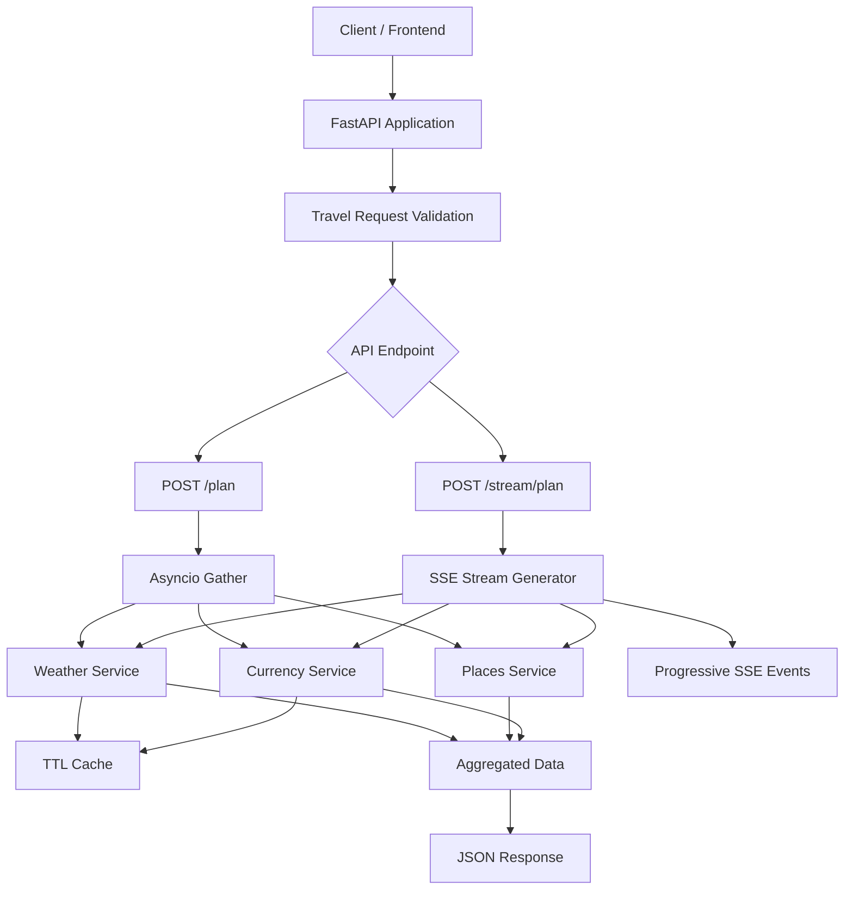

# ✈️ TripFlow – Asynchronous Travel Planning API

<p align="center">
  <b>A FastAPI-powered travel planning backend that aggregates weather forecasts, currency exchange rates, and destination-specific attractions through asynchronous API orchestration and real-time streaming.</b>
</p>

<p align="center">
  
  
  
  
  
</p>

---

## 📌 Overview

**TripFlow** is an asynchronous travel planning API designed to simplify the process of gathering essential travel information from multiple sources.

Instead of requiring clients to interact with separate services, TripFlow combines weather forecasts, currency exchange rates, and tourist attractions into a unified travel planning response.

The application uses **FastAPI, HTTPX, and Python's asyncio** to handle independent data-fetching operations concurrently. It also provides a Server-Sent Events (SSE) endpoint that progressively delivers travel information as individual services complete their execution.

A lightweight in-memory caching mechanism further reduces redundant external API requests.

## ✨ Key Features

- **Multi-Source Data Aggregation:** Combines weather forecasts, currency exchange rates, and destination-specific tourist attractions through a unified API.
- **Asynchronous Execution:** Uses `asyncio.gather()` to execute independent service operations concurrently.
- **Real-Time Streaming:** Implements Server-Sent Events (SSE) using FastAPI's `StreamingResponse` and asynchronous generators.
- **TTL-Based Caching:** Stores weather and currency API responses for one hour to reduce redundant network requests.
- **Input Validation:** Uses Pydantic models and date-range validation to ensure valid travel requests.
- **Modular Architecture:** Separates API routes, request models, external service integrations, and caching logic.
- **API Documentation:** Provides interactive API documentation through FastAPI's Swagger UI.

## 🏗️ Architecture

TripFlow follows a modular service-oriented backend architecture.



### Project Structure

```text
TravelApp/
│
├── yatra-app/
│   │
│   ├── app/
│   │   ├── main.py
│   │   ├── model.py
│   │   │
│   │   ├── routes/
│   │   │   ├── planner.py
│   │   │   └── stream.py
│   │   │
│   │   └── services/
│   │       ├── weather.py
│   │       ├── currency.py
│   │       ├── places.py
│   │       └── cache.py
│   │
│   ├── tests/
│   │   └── test_stream_serialization.py
│   │
│   └── requirements.txt
│
└── README.md
```

## ⚙️ Technology Stack

| Technology | Purpose |
|---|---|
| Python | Backend programming |
| FastAPI | REST API framework |
| Uvicorn | ASGI application server |
| HTTPX | Asynchronous HTTP requests |
| asyncio | Concurrent execution |
| Pydantic | Request validation and data modelling |
| Server-Sent Events | Progressive response streaming |
| Python Dictionary | In-memory TTL caching |
| WeatherAPI | Weather forecast integration |
| ExchangeRate-API | Currency exchange rate integration |

## 🔄 Core Implementation

### 1. Asynchronous API Aggregation

TripFlow uses Python's `asyncio.gather()` to execute independent data-fetching operations concurrently.

```python
weather_data, places_data, currency_rates = await asyncio.gather(
    fetch_weather(
        destination=travel_request.destination,
        start_date=travel_request.start_date,
        end_date=travel_request.end_date
    ),
    fetch_places(travel_request.destination),
    fetch_currency_rates(travel_request.base_currency)
)
```

**Why asynchronous execution?**

Sequential API calls require each operation to finish before the next one starts. Using `asyncio.gather()` allows independent operations to progress concurrently while waiting for network responses.

This reduces overall waiting time for I/O-bound operations.

### 2. Server-Sent Events (SSE)

TripFlow provides a streaming endpoint that sends travel information incrementally instead of waiting for the complete response.

It uses:
- FastAPI `StreamingResponse`
- Asynchronous generators
- Python `yield`
- JSON serialization for Pydantic models and date objects
- `text/event-stream` response format

**Streaming event sequence:**

| Event | Description |
|---|---|
| `start` | Travel plan aggregation begins |
| `weather` | Weather data fetching begins |
| `weather_complete` | Weather results are delivered |
| `options` | Places lookup begins |
| `options_complete` | Tourist attractions are delivered |
| `currency` | Currency data fetching begins |
| `currency_complete` | Exchange rates are delivered |
| `complete` | Aggregation finishes |

The streaming endpoint delivers these sections progressively. Unlike the standard aggregation endpoint, its current implementation fetches the services sequentially.

### 3. TTL-Based In-Memory Caching

An in-memory caching mechanism stores frequently requested weather and currency information.

Each cache entry contains:

- Cached response data
- Creation timestamp
- Time-to-live (TTL)

```python
_cache[key] = {
    "data": data,
    "timestamp": time.time(),
    "ttl": ttl
}
```

Cached data is returned when it is still valid. Expired entries are deleted, allowing the application to fetch updated information.

**Cache configuration:**

| Service | Cache duration |
|---|---|
| Weather | 3600 seconds |
| Currency | 3600 seconds |

## 📡 API Endpoints

| Method | Endpoint | Description |
|---|---|---|
| GET | `/` | API information |
| POST | `/plan/` | Generate an aggregated travel plan |
| POST | `/stream/plan` | Stream travel plan information through SSE |

### 1. Generate Travel Plan

**Endpoint:** `POST /plan/`

**Request Body:**

```json
{
  "destination": "Goa",
  "start_date": "2026-11-10",
  "end_date": "2026-11-13",
  "base_currency": "INR"
}
```

**Response Structure:**

```json
{
  "message": "Travel plan created successfully",
  "weather_data": [],
  "places_data": [],
  "currency_rates": {}
}
```

The weather and places arrays contain structured data returned by their respective services. Currency rates contain the conversion-rate mapping.

### 2. Stream Travel Plan

**Endpoint:** `POST /stream/plan`

**Content-Type:** `application/json`

**Response Content-Type:** `text/event-stream`

This endpoint progressively sends weather, places, and currency results through named SSE events.

Example event:

```text
event: weather_complete
data: {"weather_data": [...]}
```

This allows clients to process completed sections without waiting for all three services to finish.

## 🚀 Getting Started

### Prerequisites

- Python 3.11 or later
- pip
- WeatherAPI account and API key
- ExchangeRate-API account and API key

### 1. Clone the Repository

```bash
git clone https://github.com/awasthypranshu/TravelApp.git

cd TravelApp/yatra-app
```

### 2. Create a Virtual Environment

```bash
python -m venv venv
```

Activate it:

**Windows:**

```bash
venv\Scripts\activate
```

**Linux / macOS:**

```bash
source venv/bin/activate
```

### 3. Install Dependencies

```bash
pip install -r requirements.txt
```

### 4. Configure API Credentials

Obtain your API credentials from:

- [WeatherAPI](https://www.weatherapi.com/)
- [ExchangeRate-API](https://www.exchangerate-api.com/)

For secure configuration, create a `.env` file inside `yatra-app`:

```env
WEATHER_API_KEY=your_weather_api_key
EXCHANGE_API_KEY=your_exchange_api_key
```

**Important:** Before using this configuration, update `services/weather.py` and `services/currency.py` to read their respective API keys using `os.getenv()` and `python-dotenv`. The current repository source contains hardcoded credentials, which should be moved to environment variables and rotated if they have been exposed.

Add `.env` to `.gitignore` so credentials are never committed.

### 5. Run the Application

Navigate to the application directory:

```bash
cd app
```

Start the FastAPI server:

```bash
uvicorn main:app --reload
```

The application will be available at:

```text
http://127.0.0.1:8000
```

### 6. Explore API Documentation

Open the interactive Swagger documentation:

```text
http://127.0.0.1:8000/docs
```

Use Swagger UI to submit travel requests and inspect API responses.

## 🧪 Testing

The project includes a unit test for SSE serialization of Pydantic models.

Run the test suite from the `yatra-app` directory:

```bash
python -m unittest discover -s tests -v
```

## 📈 Future Enhancements

- Replace the in-memory cache with Redis for distributed caching.
- Integrate a live Places API to retrieve real-time destination information.
- Add structured exception handling, API timeouts, and retry mechanisms.
- Implement concurrent service execution in the SSE endpoint.
- Introduce automated API and integration testing.
- Add cache statistics and cache-management endpoints.
- Introduce a frontend for interactive travel planning.

## 👨‍💻 Author

**Pranshu Awasthy**

Computer Science Undergraduate | Backend Engineering | Generative AI

<p align="left">
  <a href="https://github.com/awasthypranshu">GitHub</a> •
  <a href="https://www.linkedin.com/in/pranshu-awasthy-a008a6282/">LinkedIn</a>
</p>

---

<p align="center">
  <b>Built with Python, FastAPI, and asynchronous programming.</b>
</p>
